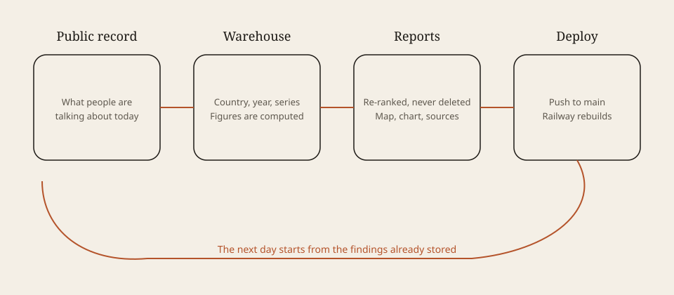

# Global Population Intelligence

A reading room for public statistics. The app watches what is in the public conversation, then reports the country-year trends that sit underneath those topics: homicide, diet, alcohol, battle deaths, income, and temperature. Headlines decide which report is in front. The warehouse decides the numbers. A correlation on the page is not a cause.

The design stays paper, ink, and copper. Each day's pass may refine a layout or add a series, but it does not invent a second look, and it does not delete a report. Rankings move. Pages stay.

## How it adapts

1. **Public record.** A pass searches what people are discussing in conflict, crime, drugs, diet, climate, and income. The note is stored in `interest_findings`, dated, and kept.
2. **Warehouse.** Figures are calculated from the country-year series when the page loads. Changing the year or the country changes every figure that depends on it. Preliminary years, including 2026 battle deaths, stay labeled as partial.
3. **Reports.** The home page orders topics by that day's priority, then by how complete the evidence is. Each report has its own URL. It shows the map, a chart, the sources, related articles and posts with a published bias mark or "Unrated", and people only when a cited source names them.
4. **Deploy.** A push to `main` rebuilds the Railway image from the Dockerfile. Migrations run when the server starts, against the existing PostGIS database.

Nothing about a person who uses the app is stored.

## Run

Live: [global-population-intelligence-production.up.railway.app](https://global-population-intelligence-production.up.railway.app)

`npm start` applies `migrations/*.sql`, then serves the Node app on `PORT`. Health check: `/api/health`.

The development plan and the rules for each automated pass are in [docs/GPI_PLAN.md](docs/GPI_PLAN.md). The issue tracker for those passes is grouped by execution date. See `docs/tracker.json`.
